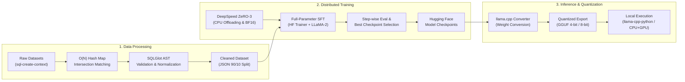

# SQL-LLaMA: Distributed Text-to-SQL Fine-Tuning Pipeline

[](https://www.python.org/)
[](https://pytorch.org/)
[](https://huggingface.co/)
[](https://github.com/microsoft/DeepSpeed)
[](LICENSE)
[](https://github.com/psf/black)

---

## 📖 Executive Summary

**SQL-LLaMA** is an end-to-end, production-grade distributed pipeline engineered for full-parameter supervised fine-tuning (SFT) of LLaMA foundation models into domain-specialized relational Text-to-SQL semantic parsers. Designed to handle complex multi-table schema contexts and dialect constraints, the architecture leverages **DeepSpeed ZeRO-3** memory optimization for distributed multi-GPU training alongside automated **Abstract Syntax Tree (AST)** validation via `sqlglot` to verify, normalize, and curate clean relational queries prior to tokenization.

---

## 🏗️ Architectural Overview



---

## ⚡ Key Engineering Features

* **Algorithmic Data Curation**: Replaced naive quadratic $O(N \times M)$ nested search loops with an amortized $O(N)$ Hash Map lookup for schema-query matching. Replaced naive substring counting with word-boundary regular expressions (`\bKEYWORD\b`) to eliminate false matches inside SQL table and column identifiers.
* **Robust AST Syntax Validation**: Integrated `sqlglot` Abstract Syntax Tree parsing (`SQLValidator`) with granular exception trapping to validate relational syntax, enforce dialect normalization (SQLite/ANSI), and discard malformed queries prior to model ingestion.
* **Distributed Training Infrastructure**: Implemented **DeepSpeed ZeRO-3** memory partitioning with contiguous gradients, BF16 mixed-precision arithmetic, and CPU parameter/optimizer offloading to fine-tune 7B and 13B parameter architectures on resource-constrained multi-GPU clusters.
* **Evaluation & Checkpointing Strategy**: Eliminated "blind training" by implementing deterministic 90/10 train-validation dataset partitioning, step-wise cross-entropy evaluation (`eval_steps=100`), and automated best-checkpoint restoration (`load_best_model_at_end=True`).
* **Quantized Edge Deployment**: End-to-end checkpoint export workflow converting Hugging Face weights to quantized GGUF format (4-bit/8-bit) for high-throughput, low-latency CPU and GPU inference via `llama.cpp`.

---

## 📁 Repository Structure

```
06_sqlllama-text-to-sql-finetuning/
├── .gitignore                      # Hardened Git ignore rules (excludes raw JSON, weights, env)
├── LICENSE                         # Apache 2.0 open-source license
├── README.md                       # Architectural showcase and execution guide
├── pyproject.toml                  # PEP 621 package metadata & optional dependency groups
├── requirements.txt                # Production-pinned Linux/CUDA dependencies
├── run_training.sh                 # Parameterized distributed training launcher
├── convert_llama_weights_to_hf.py  # Meta LLaMA checkpoint to Hugging Face converter
├── download.sh                     # Meta LLaMA-2 model weight acquisition utility
├── configs/                        # Distributed training configurations
│   └── ds_config_sql.json          # DeepSpeed ZeRO-3 distributed memory configuration
├── src/                            # Modular Python package source
│   └── sqlllama/
│       ├── __init__.py
│       ├── data/                   # Data engineering, sampling, and AST cleaning
│       │   ├── __init__.py
│       │   ├── ast_cleaner.py      # Abstract Syntax Tree (AST) SQL validator & normalizer
│       │   ├── prepare_dataset.py  # Sequence length power-sampling dataset extractor
│       │   ├── prepare_dataset_small.py # Hash-mapped subset filter & regex keyword analyzer
│       │   └── statistics_datasets.py   # Distribution analytics and keyword statistics
│       ├── training/               # Distributed SFT training modules
│       │   ├── __init__.py
│       │   └── trainer.py          # Distributed SFT trainer with 90/10 eval validation
│       ├── inference/              # Inference and quantized deployment runners
│       │   ├── __init__.py
│       │   └── runner.py           # Parameterized GGUF inference client (llama-cpp-python)
│       └── utils/                  # Shared domain utilities
│           ├── __init__.py
│           └── sql_analyzer.py     # Precompiled word-boundary SQL KeywordAnalyzer
├── tests/                          # Automated PyTest test suite
│   ├── __init__.py
│   ├── test_ast_cleaner.py         # Unit tests for SQLGlot AST validation & normalizer
│   └── test_analyzer.py            # Unit tests for precompiled regex KeywordAnalyzer
├── datasets/                       # Local directory for raw and processed datasets (untracked)
└── models_hf/                      # Quantization utilities & conversion scripts
    ├── convert.py                  # llama.cpp weight converter
    └── command.txt                 # CLI conversion command reference
```

---

## 🛠️ Quick Setup (Installation)

### Prerequisites
* **Operating System**: Linux (Ubuntu 20.04/22.04 LTS recommended) or Windows with Python 3.10+
* **Compute**: NVIDIA GPU with CUDA 11.7+ or 12.0+ (24GB+ VRAM recommended for ZeRO-3 offload)
* **Python**: Version 3.10 or higher

### Environment Setup

```bash
# 1. Clone repository
git clone https://github.com/Taha-JN/06_sqlllama-text-to-sql-finetuning.git
cd 06_sqlllama-text-to-sql-finetuning

# 2. Initialize Python virtual environment
python3 -m venv .venv
source .venv/bin/activate  # On Windows: .venv\Scripts\activate

# 3. Install package in editable mode with development dependencies
pip install --upgrade pip
pip install -e ".[dev,inference]"
```

---

## 🚀 Execution Workflow (End-to-End)

### Step 1: Data Preparation & AST Cleaning
Download and curate the relational Text-to-SQL context dataset, followed by AST syntax verification:
```bash
# Generate raw sampled dataset from b-mc2/sql-create-context
python -m sqlllama.data.prepare_dataset

# Validate and normalize queries via SQLGlot AST parsing
python -m sqlllama.data.ast_cleaner \
    --input_path "./datasets/sql_create_dataset.json" \
    --output_path "./datasets/sql_create_dataset_cleaned.json" \
    --read_dialect "sqlite" \
    --write_dialect "sqlite"
```

### Step 2: Distributed Fine-Tuning
Execute distributed full-parameter fine-tuning using `torchrun` and DeepSpeed ZeRO-3. The launcher dynamically provisions port, batch sizes, and gradient accumulation:
```bash
# Basic run with defaults (7B Model, ZeRO-3, 5 Epochs):
bash run_training.sh 7B configs/ds_config_sql.json

# Custom configuration (13B Model, 3 Epochs, Batch Size 8):
bash run_training.sh 13B configs/ds_config_sql.json ./datasets/sql_create_dataset_cleaned.json 3 8 16
```

### Step 3: Checkpoint Conversion & Quantization
Export distributed checkpoints into Hugging Face and quantized GGUF format:
```bash
# Convert base Meta weights to Hugging Face format (if needed)
python convert_llama_weights_to_hf.py --input_dir ./models/ --model_size 7B --output_dir ./models_hf/7B

# Export fine-tuned weights for llama.cpp execution
python models_hf/convert.py output_sqlAlpaca7B/
```

### Step 4: Local Quantized GGUF Inference
Execute low-latency local inference with custom instructions using `llama-cpp-python`:
```bash
python -m sqlllama.inference.runner \
    --model_path "./models/sqlllama-7b-q4_k_m.gguf" \
    --instruction "Show department names with more than 10 employees." \
    --context "CREATE TABLE department (id INT, name VARCHAR, num_employees INT)"
```

### Step 5: Run Automated Tests
Execute the PyTest test suite to verify AST query parsing and regex keyword extraction:
```bash
pytest tests/ -v
```

---

## 🙏 Acknowledgments & Attribution

This project builds upon foundational tools and research from the open-source machine learning community:
* **[Stanford Alpaca](https://github.com/tatsu-lab/stanford_alpaca)**: Base distributed supervised training and token masking harness logic (`train.py`, Apache-2.0 License).
* **[Meta AI](https://github.com/facebookresearch/llama)**: Foundation LLaMA-2 model architectures and download infrastructure.
* **[Hugging Face](https://github.com/huggingface/transformers)**: Transformers `Trainer`, Dataset utilities, and conversion scripts.
* **[llama.cpp](https://github.com/ggerganov/llama.cpp)**: High-performance GGUF weight quantization and CPU/GPU inference bindings.
* **[SQLGlot](https://github.com/tobymao/sqlglot)**: Relational Abstract Syntax Tree (AST) transpilation, parsing, and query normalization.
